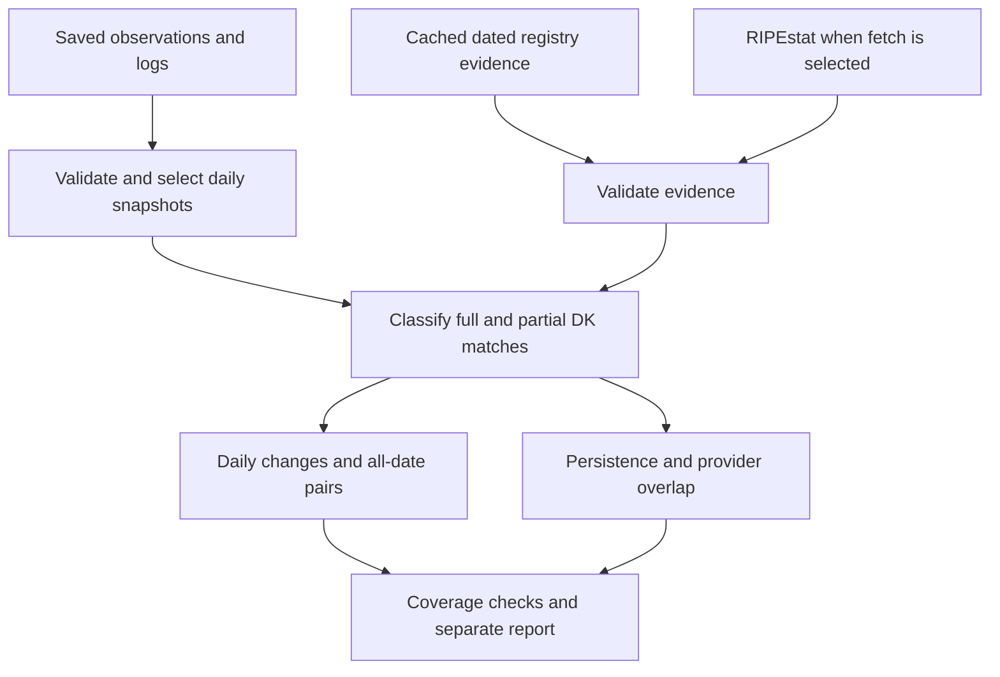

# Program structure and design

This extension uses Python's standard library: `csv` for tables, `json` for evidence/manifests, `urllib` for the one public API, `ipaddress` for canonical IP/CIDR validation, `bisect` for interval lookup, `hashlib` for checksums, and `datetime` for UTC dates. SVG and HTML are generated directly from calculated values. No database, Docker, geolocation package or paid API is required.

## Files

| File | Responsibility |
|---|---|
| `scripts/danish_study.py` | CLI/menu, input audit, dated country evidence, classification, analysis and HTML/SVG/CSV outputs. |
| `tests/test_danish_study.py` | Offline unit/integration tests with temporary synthetic data; never writes to the research dataset. |
| `DANISH_ANALYSIS_README.md` | Commands, method, interpretation, outputs, missing-data rules and limitations. |
| `DANISH_ANALYSIS_STRUCTURE.md` | This code map. |

The installer adds only these four files. If they already exist, it saves timestamped backups of those files before replacing them. Existing project scripts and results are not replaced.

## Classes

| Class | Purpose |
|---|---|
| `Snapshot` | Holds one source snapshot's identity, UTC date/time, raw path/hash, canonical indicator keys, duplicate/error counts and eligibility flags. It is a dataclass, not a downloader. |
| `Ranges` | Stores merged IPv4 and IPv6 intervals from DK registry prefixes. Its `match()` method returns full/partial/no match and the precise matched intervals. Binary search finds candidate intervals without expanding CIDRs into hosts. |
| `DanishStudyTests` | The test suite in the tests file. This is not part of research-data processing. |

Most processing is in functions. Calling every script a class would misdescribe this program.

## Main functions

| Function | What it does |
|---|---|
| `main()` | Reads CLI flags and chooses menu, run listing or an analysis. |
| `menu()` | Gives a simple menu; launches a new process for the selected action. Option 5 invokes the original menu without modifying it. |
| `run()` | Coordinates loading, evidence, classification, analysis, checks and report creation in a unique run folder. |
| `load_snapshots()` | Validates the input schema and row provenance, groups by source/date/snapshot, selects latest snapshots, checks raw hashes and reconciles collection logs. |
| `local_raw()` | Resolves moved project raw paths beneath the current project's `data/raw`; rejects path traversal. |
| `evidence_for_day()` | Verifies saved evidence or requests the dated country list from RIPEstat when `--fetch` is used. Archives response and metadata. |
| `validate_evidence()` | Requires successful JSON, the requested date, DK identity when supplied, and valid IPv4/IPv6 prefixes. |
| `network()` | Parses and caches canonical IP/CIDR keys. An IP becomes a one-address network for interval calculations. |
| `merge()`, `intersection()`, `size()`, `cidrs()` | Deduplicate intervals, find common address space, count it exactly and format the matched subranges. |
| `make_frame()` | Classifies every selected entry, writes the all-entry and Danish-only CSVs, and builds sets/ranges for analysis. |
| `metrics()` | Computes additions, removals, unchanged counts, net/percentage change and Jaccard similarity from sets. |
| `compare_dates()` | Compares global, full-DK and any-DK sets; separates feed membership changes from registry-scope changes. Missing inputs remain unknown. |
| `address_changes()` | Compares deduplicated Danish address coverage for IPv4 and IPv6 separately. |
| `persistence()` | Calculates observed presence, eligible sampled days, consecutive-day streaks, reappearance after sampled absence, and boundary/gap flags. |
| `overlap_and_exclusive()` | Compares providers on the same date using exact indicators and covered address space; identifies exclusive contribution. |
| `fixed_registry_sensitivity()` | Repeats classification using the earliest available map on every date, for comparison with the primary dated method. |
| `chart_svg()` | Draws precise charts from result values; preserves missing-day gaps. |
| `write_report()` | Builds the local HTML report, links to evidence tables and explains limitations. |
| `show_runs()` | Lists completed runs by ID with their study windows and report paths. |

## Example: pressing option 2

1. `menu()` launches this script with `--fetch` and any selected date limits.
2. `main()` passes these choices to `run()`.
3. `load_snapshots()` reads the existing observations and collection log, verifies the available raw files, and selects one snapshot per source/day.
4. `evidence_for_day()` checks the cache, then calls the fixed RIPEstat endpoint only when evidence is missing or invalid. It requests DK ranges for the observation date, not today's ranges for every date.
5. `Ranges.match()` and `make_frame()` classify IP/CIDR entries and write the audit trail.
6. Set and interval functions compute temporal changes, persistence, overlap and exclusive contribution. All-date-pair summaries are saved separately from daily changes.
7. Validation checks the classification partitions, comparison identities and input stability. The report displays warnings and coverage gaps.
8. `write_report()` creates `report.html`; `run()` finishes the manifest and prints the exact paths.

## Validation boundaries

Hash checks establish that bytes match a recorded value; they do not establish that a provider's accusation is correct. Country evidence establishes the operational registration association only. Missing or invalid evidence is never invented. Successful analysis does not supply delisting case records, literature selection records, or independent reputation results.

Inputs are read-only. New analysis files and cached registry evidence are additional artifacts. `run_manifest.json` records the observations, collection-log and code checksums, and all generated output hashes. Preserve the referenced evidence cache alongside each run. A future change to parsing or the country definition must be documented as a new method version and rerun consistently over the period.
